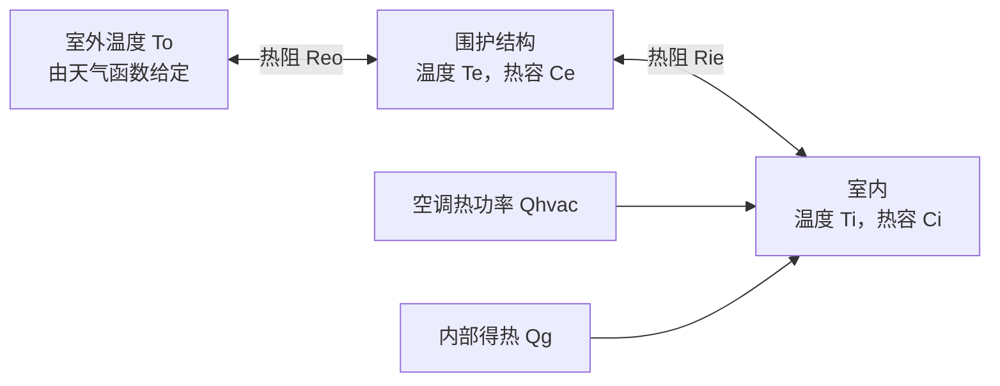

对。先把队友这套模型理解透，后面训练和解释结果都会容易很多。

**这套环境的温度变化由固定的物理公式计算，PPO 学习的是“在什么情况下，该开多大的空调”。** 热阻、热容这些物理参数不会随着 PPO 训练而改变。

先看控制器收到的 **11 维观测**。源码中的顺序定义在 [env.py](../../RL_assignment/hvac_env/env.py#L20)：

| 索引 | 字段 | 含义及单位 | 控制器为什么需要它 |
|---|---|---|---|
| 0 | `T_i` | 当前室内温度，°C | 判断现在冷不冷、热不热 |
| 1 | `T_e` | 当前围护结构的等效温度，°C | 判断墙体接下来会给室内放热还是吸热 |
| 2 | `T_o` | 当前室外温度，°C | 了解外界热环境 |
| 3 | `Q_g` | 当前内部得热功率，kW | 了解人员、设备和日间得热带来的热负荷 |
| 4 | `comfort_low` | 舒适温度下限，°C | 知道最低允许温度 |
| 5 | `comfort_high` | 舒适温度上限，°C | 知道最高允许温度 |
| 6 | `sin_hour` | 日内时刻的正弦编码 | 识别一天中的时间 |
| 7 | `cos_hour` | 日内时刻的余弦编码 | 与正弦共同确定时刻 |
| 8 | `scenario_cold` | 是否为冷天气，0 或 1 | 告知天气场景 |
| 9 | `scenario_hot` | 是否为热天气，0 或 1 | 同上 |
| 10 | `scenario_transition` | 是否为过渡天气，0 或 1 | 同上 |

因此，**11 维观测并不代表 11 个需要求解的物理状态**。真正随热平衡方程演化的只有前两个温度，其余是外部条件、任务目标和辅助编码。

这里有两个编码细节：

- 时间采用 \(\sin(2\pi h/24)\)、\(\cos(2\pi h/24)\)。例如午夜约为 `(0, 1)`，早上六点为 `(1, 0)`，中午为 `(0, -1)`。这样午夜前后的时间在数值上也相邻，符合一天循环的性质。
- 天气采用独热编码：冷天气 `[1,0,0]`，热天气 `[0,1,0]`，过渡天气 `[0,0,1]`。

接着看房间本身。队友采用的是 **2R2C 集总热模型**：两个热阻、两个热容，把复杂建筑简化成两个储热节点。



“围护结构”通常指墙体、屋顶等建筑外壳。在这个模型里，\(T_e\) 是把相关结构合并后的**等效温度**，不是某一面墙上某个点的实际测量温度。

同样，室内热容 \(C_i\) 也不只是空气的热容，还代表与室温较快发生热交换的等效储热部分，比如家具等。当前模型没有分别描述每面墙、每件家具。

**热阻决定有多少热量流过，热容决定温度改变得有多快。**

热阻对应的基本关系是：

\[
\text{热流功率}=\frac{\text{两端温差}}{\text{热阻}}
\]

例如室内是 \(24^\circ C\)，围护结构是 \(20^\circ C\)，则从围护流向室内的热功率为：

\[
\frac{T_e-T_i}{R_{ie}}
=\frac{20-24}{27.81}
\approx-0.144\ \mathrm{kW}
\]

负号表示室内正在向围护结构散热。温差越大，热流越大；热阻越大，同样温差下的热流越小。

热容对应的关系是：

\[
\text{储存的热量变化}=C\times\text{温度变化}
\]

所以，给定同样的净输入热功率：

\[
\text{温度变化速度}=\frac{\text{净输入热功率}}{C}
\]

当前默认参数见 [default.yaml](../../RL_assignment/hvac_env/configs/default.yaml#L2)：

| 参数 | 默认值 | 含义 |
|---|---:|---|
| \(R_{ie}\) | 27.81 °C/kW | 室内与围护之间的热阻 |
| \(R_{eo}\) | 3.02 °C/kW | 围护与室外之间的热阻 |
| \(C_i\) | 1.11 kWh/°C | 室内节点的等效热容 |
| \(C_e\) | 2.11 kWh/°C | 围护节点的等效热容 |

例如，假设没有其他换热，给室内节点持续输入 1 kW、持续 1 小时，输入热量就是 1 kWh，室温将上升约：

\[
\Delta T_i=\frac{1}{1.11}\approx0.90^\circ C
\]

这就是“温度变化具有惯性”的具体含义：空调输入先改变储热量，温度随着累积的热量逐渐改变。

把这些关系组合起来，得到队友使用的两条方程，实现在 [thermal.py](../../RL_assignment/hvac_env/thermal.py#L27)：

\[
\boxed{
C_i\frac{dT_i}{dt}
=
\underbrace{\frac{T_e-T_i}{R_{ie}}}_{围护与室内换热}
+
\underbrace{Q_{\mathrm{hvac}}}_{空调供暖或制冷}
+
\underbrace{Q_g}_{内部得热}
}
\]

\[
\boxed{
C_e\frac{dT_e}{dt}
=
\underbrace{\frac{T_o-T_e}{R_{eo}}}_{室外与围护换热}
+
\underbrace{\frac{T_i-T_e}{R_{ie}}}_{室内与围护换热}
}
\]

每条方程都遵循同一个原则：**节点的储热变化速度，等于流入该节点的净热功率。**

注意，室内和围护之间的换热，在两条方程里符号相反：室内失去的热量由围护获得，符合能量守恒。这里的 \(Q\) 表示热功率，单位是 kW；随时间累积的热量才是 kWh。

这个连接方式还有一个具体假设：室外通过围护结构影响室内，没有额外加入一条“室外直接到室内”的通风换热通道。

**为什么要保留围护温度，而不只用室温？** 因为同样是室内 \(24^\circ C\)，墙体很冷和墙体很热，后续温度变化会不同：

- 围护温度低，室内会继续向围护散热。
- 围护温度高，围护会继续向室内放热，关闭制冷后室温可能回升。

因此，只看室温无法完整描述储热状态。队友把 \(T_e\) 直接提供给控制器，是一种完整状态可观测的仿真假设；实际建筑中通常还需要估计这个等效温度。

再看方程里的外部输入，它们也有明确的生成方法。

**室外温度由日周期函数生成**，实现在 [weather.py](../../RL_assignment/hvac_env/weather.py#L68)：

\[
T_o(h)=\mu+\delta+A\sin\left(\frac{2\pi(h-9)}{24}\right)
\]

其中，\(\mu\) 是日均温基准，\(A\) 是振幅，\(\delta\) 是每回合抽取一次的天气偏移，默认在 \([-2,2]^\circ C\) 均匀采样。

| 场景 | 日均温基准 \(\mu\) | 振幅 \(A\) | 舒适区间 |
|---|---:|---:|---|
| 冷天气 | 5°C | 6°C | 20–23.5°C |
| 热天气 | 31°C | 6°C | 23–26°C |
| 过渡天气 | 19°C | 8°C | 20–23.5°C |

这个函数在下午三点最热、凌晨三点最冷。同一回合内每天重复相同的日周期，没有逐时随机天气噪声。

**内部得热 \(Q_g\)** 则由三部分相加：

- 全天存在的基础得热：0.05 kW。
- 08:00–18:00 的办公得热：额外 0.15 kW。
- 06:00–18:00 的半正弦日间得热：中午达到峰值 0.15 kW。

因此，中午总得热是 \(0.35\ \mathrm{kW}\)。这相当于对人员、设备和日间热负荷做了简化描述。

**空调动作转换成热功率后，才进入温度方程。** 默认两个方向容量都是 1 kW，所以：

\[
Q_{\mathrm{hvac}}=u\times1\ \mathrm{kW},
\qquad u\in[-1,1]
\]

例如 \(u=-0.5\) 表示制冷、从室内移除 0.5 kW 的热功率。默认 COP 为 3，因此设备电功率为：

\[
P_{\mathrm{electric}}=\frac{0.5}{3}\approx0.167\ \mathrm{kW}
\]

温度方程使用热功率，用电统计使用电功率，两者通过 COP 联系起来。

最后，把整个过程放进一个具体例子。**假设过渡天气中午 12 点，天气偏移为 0，当前室温 24°C、围护温度 20°C。** 此时观测约为：

```text
[24, 20, 24.657, 0.35, 20, 23.5, 0, -1, 0, 0, 1]
```

如果控制器选择 \(u=-0.5\)，那么室内节点此刻的净输入热功率是：

\[
\frac{20-24}{27.81}-0.5+0.35
\approx-0.294\ \mathrm{kW}
\]

所以此刻的室温变化速度是：

\[
\frac{dT_i}{dt}
=\frac{-0.294}{1.11}
\approx-0.265^\circ C/\mathrm{h}
\]

不过，随着室温和围护温度变化，这个速度也会变化。代码将连续方程转为离散形式：

\[
x_{k+1}=A_dx_k+B_dv_k
\]

其中 \(x=[T_i,T_e]^T\)，\(v=[Q_{\mathrm{hvac}},Q_g,T_o]^T\)。它采用零阶保持离散化：假设外部输入在这 15 分钟内恒定，同时计算两个温度在区间内的连续演化。

我按源码公式和默认参数核算，这一步之后：

| 量 | 结果 |
|---|---:|
| 室内温度 | 24 → 约 **23.935°C** |
| 围护温度 | 20 → 约 **20.195°C** |
| 这一步用电量 | 约 **0.04167 kWh** |

室温下降，是因为制冷和向围护散热超过了内部得热；围护温度上升，是因为它从较暖的室外和室内吸收了热量。

随后环境用**步后室温**计算越界距离和奖励，再返回 12:15 的新观测。舒适温区只参与评价和策略决策，不会把物理温度强行限制在区间内。

每个新回合开始时，环境还会抽取天气场景、天气偏移和初始室温；默认围护初温通过“初始围护净热流为零”的条件计算。这样就有了完整的运行链：**设定初始状态和外部条件，接收动作，用热平衡推进温度，再计算舒适度与能耗。**
